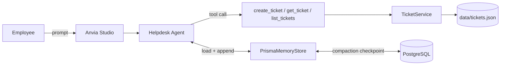

# Helpdesk Agent — Anvia + Prisma memory

An internal IT helpdesk agent that runs in **Anvia Studio**, calls its own ticket
tools, and keeps durable conversation memory in **PostgreSQL via Prisma**, with
automatic **context compaction** once a conversation grows past a token budget.

Built with the [Anvia](https://docs.anvia.dev/) runtime (`@anvia/core`), an
[OI]-compatible model, and `@anvia/memory-prisma`.

---

## 1. What the agent does

You talk to it like an employee reporting a problem. It asks for the missing
facts, opens a ticket, and remembers the conversation for later turns.

| Tool | Kind | What it does |
| --- | --- | --- |
| `create_ticket` | side effect | Opens a ticket for the current user: title, description, optional priority. |
| `get_ticket` | read | Reads one ticket by id (`TCK-1001`) — status, priority, description. |
| `list_tickets` | read | Lists tickets newest first, scoped to the current user unless `allUsers` is set. |

The requester identity comes from the application (`DEMO_USER_ID`), never from the
model, so the model cannot read or write another user's tickets.

## 2. How it fits together



- `src/agent/` owns the model, instructions, memory store, compaction policy, and the agent factory.
- `src/helpdesk/` owns the domain: the ticket service and the tools that adapt it.
- `src/config.ts` is the only place that reads environment variables, so a bad value fails at startup.
- `prisma/` holds the data contract and the database client; `migrations/` holds the applied migration.

## 3. Requirements

- Node.js 24+ and pnpm 11+
- Docker + Docker Compose (for PostgreSQL)
- An API key for [OI] or another [OI]-compatible provider

## 4. Step-by-step: first run

Every step below is copy-pasteable from the project root.

### Step 1 — Install dependencies

```bash
pnpm install
```

### Step 2 — Create your environment file

```bash
cp .env.example .env
```

Open `.env` and set at least `OPENAI_API_KEY`. Everything else has a working
default (see [Configuration](#8-configuration)).

### Step 3 — Start PostgreSQL

```bash
docker compose up -d db
```

Expected: a `db` container listening on host port **5545** (configurable with
`DB_PORT`). Verify:

```bash
docker compose ps
```

### Step 4 — Create the memory tables

```bash
pnpm db:init
```

This applies the Prisma 8 contract in `prisma/contract.prisma`, creating
`AgentMemorySession`, `AgentMemoryMessage`, and `AgentMemoryError`. Confirm the
database matches the contract:

```bash
pnpm db:verify     # -> "Database marker and schema match contract"
```

### Step 5 — Start Anvia Studio

```bash
pnpm dev
```

Expected output:

```text
Studio UI: http://localhost:4021/playground
```

Open that URL. The sidebar shows **Helpdesk Agent** with three quick prompts, and
the **Tools** page lists `create_ticket`, `get_ticket`, `list_tickets`.

## 5. Step-by-step: using the agent in Studio

1. Open <http://localhost:4021/playground>.
2. Click the quick prompt *"My laptop keeps dropping the office VPN every few minutes. Please open a ticket for me."*
3. The agent asks for the missing details (since when, what you tried). Answer in the input box and press send:

   ```text
   It started this morning. I already restarted the laptop. It blocks month-end work, so mark it high priority.
   ```

4. Watch the run: the tool call appears as a **`create_ticket`** card, followed by the answer with the new ticket id, for example `TCK-1002`.
5. Ask a follow-up that needs the earlier turn:

   ```text
   What is the status of the ticket you just opened for me?
   ```

   The agent answers from stored history, without you repeating the id.
6. Inspect the run in the sidebar:
   - **Memory** — persisted conversations and messages, read straight from PostgreSQL.
   - **Traces** — per-run tool calls, timings, token usage.
   - **Tools** — the tool catalogue with input schemas, plus a *Run* action to invoke a tool directly.

Every turn you send in one Studio session is stored under that session id, so
closing the browser and returning later still continues the same conversation.

## 6. Step-by-step: watching memory and compaction in the database

Compaction is opt-in and threshold-driven. The default budget (8000 tokens) is
deliberately larger than a demo conversation, so lower it to observe it:

```bash
MEMORY_COMPACTION_AFTER_TOKENS=300 MEMORY_COMPACTION_RECENT_TOKENS=50 pnpm dev
```

Then:

1. Send three turns in Studio (a problem, the details, and a question about the ticket).
2. On the turn that crosses the budget, the run log prints a `memory_compaction` event and the UI run shows the summarized context instead of the full transcript.
3. Confirm the checkpoint landed in PostgreSQL:

   ```bash
   docker compose exec -T db psql -U anvia -d anvia -c \
     'SELECT "sessionId", ("compactionState" IS NOT NULL) AS checkpoint, "compactionState"->'"'"'generation'"'"' AS generation FROM "AgentMemorySession";'
   ```

   Expected: `checkpoint = t`, `generation` ≥ 1.

4. Confirm the canonical transcript is still complete — compaction never deletes messages, it only changes what the *model* sees:

   ```bash
   docker compose exec -T db psql -U anvia -d anvia -c 'SELECT count(*) FROM "AgentMemoryMessage";'
   ```

   The same full history is visible in Studio under **Memory**.

Browse the tables in a UI instead:

```bash
docker compose up -d adminer     # http://localhost:8086
```

System `PostgreSQL`, server `db`, username `anvia`, password `anvia`, database `anvia`.

## 7. Step-by-step: the CLI demo

No browser needed — three turns against one remembered session, then a report of
what was stored:

```bash
pnpm demo
```

Expected shape of the output — turn 1 collects the missing details, turn 2 opens the
ticket, turn 3 answers from stored history:

```text
> Hi, I am Rizal from the finance team. Since this morning my laptop drops the office VPN ...
Thanks, Rizal. Before I open the ticket, please provide: ...

> Yes, please open a ticket. This blocks my month-end work, so mark it high priority.
Your high-priority ticket has been opened: TCK-1001 ...

> What is the status of the ticket you just opened for me?
The ticket is currently open ...

[stored conversations] [ { sessionId: 'demo-thread', messageCount: 10, userId: 'user_456' } ]
[manual compaction] { type: 'compacted', originalMessageCount: 9, ... }
```

To see automatic compaction fire in the same demo:

```bash
MEMORY_COMPACTION_AFTER_TOKENS=300 MEMORY_COMPACTION_RECENT_TOKENS=50 pnpm demo
```

To reset the demo tickets, delete the file the service writes:

```bash
rm -rf data
```

## 8. Configuration

All of these live in `.env` and are read once, in `src/config.ts`.

| Variable | Default | Purpose |
| --- | --- | --- |
| `OPENAI_API_KEY` | — (required) | Provider credential. |
| `OPENAI_BASE_URL` | provider default | Set for an [OI]-compatible gateway. |
| `MODEL_ID` | `gpt-5.6-luna` | Chat model for the agent and the summarizer. |
| `DATABASE_URL` | — | PostgreSQL connection used by Prisma. |
| `DB_PORT` / `ADMINER_PORT` | `5545` / `8086` | Host ports published by `docker compose`. |
| `MEMORY_COMPACTION_AFTER_TOKENS` | `8000` | Compact when the model-facing context exceeds this. |
| `MEMORY_COMPACTION_RECENT_TOKENS` | `2000` | Keep the newest turns verbatim (must be smaller than the trigger). |
| `DEMO_USER_ID` | `user_456` | Requester identity attached to tool calls. |
| `TICKETS_FILE` | `data/tickets.json` | Ticket storage for the demo service. |
| `STUDIO_PORT` | `4021` | Studio UI port. |

## 9. Data model

| Model | Purpose |
| --- | --- |
| `AgentMemorySession` | Conversation scope, metadata, and the compaction checkpoint (`compactionState`). |
| `AgentMemoryMessage` | Ordered canonical messages, one row per message. |
| `AgentMemoryError` | Failed runs and the messages involved. |

Contract changes go through Prisma:

```bash
pnpm contract:emit      # regenerate contract.json / contract.d.ts after editing prisma/contract.prisma
pnpm db:verify          # check the database against the contract
```

## 10. Swapping the ticket storage

The tools depend on the `TicketService` interface in `src/helpdesk/service.ts`, not
on the file-backed implementation. To use a real database, implement that
interface and pass it in `src/agent/index.ts` — the tools, the agent, and the
memory layer stay untouched.

## 11. Troubleshooting

**Studio runs fail with `invalid-tool-call`.** The configured gateway attaches a
`usage` object to every streamed chat-completions chunk, and `@anvia/openai`
treats any chunk carrying `usage` as the terminal chunk — the next chunk then
aborts the run. `src/agent/model.ts` wraps the model: it takes the non-streaming
completion and replays it as synthetic `text_delta` / `reasoning_delta` /
`tool_call` events, which keeps streaming clients working. Trade-off: one model
call's content arrives as a single chunk instead of token by token. Remove the
wrapper when the gateway stops emitting per-chunk `usage`.

**`Missing required environment variable OPENAI_API_KEY`.** `.env` is missing or
empty; copy `.env.example` and fill it in.

**`MEMORY_COMPACTION_RECENT_TOKENS must be smaller than ...`.** The retained budget
must be below the trigger, otherwise compaction could never free any context.

**Studio says the port is in use.** Another process holds `4021`; set `STUDIO_PORT`
to a free port.

**`pnpm db:verify` reports a mismatch.** The database predates the current
contract. Re-run `pnpm db:init` for a fresh database, or apply pending migrations.

## 12. Project layout

```text
.
├── prisma/
│   ├── contract.prisma     # Agent-memory data contract
│   ├── contract.{json,d.ts}# Generated contract artifacts
│   └── db.ts               # Prisma database client
├── migrations/             # Applied migration history
├── src/
│   ├── index.ts            # Studio entry point
│   ├── cli.ts              # Headless multi-turn demo
│   ├── config.ts           # Environment parsing and validation
│   ├── agent/
│   │   ├── index.ts        # Composition root: service -> tools -> agent
│   │   ├── instructions.ts # System prompt
│   │   ├── memory.ts       # Prisma store + compaction policy
│   │   ├── model.ts        # Provider client, made safe for streaming
│   │   └── logger.ts       # Run logger observed by the agent
│   └── helpdesk/
│       ├── service.ts      # TicketService + file-backed repository
│       └── tools.ts        # The three agent tools
├── docker-compose.yml      # PostgreSQL + Adminer
└── prisma.config.ts        # Prisma ORM configuration
```

---

Built as the Class 8 assignment for Devscale Indonesia's *AI Product Engineering
with TypeScript* bootcamp.
